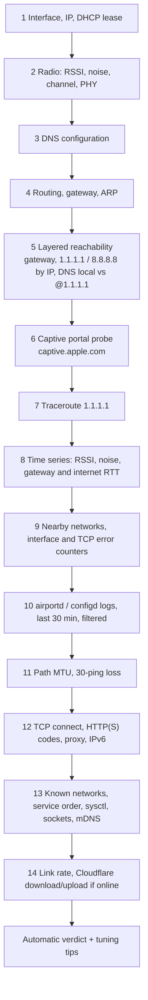
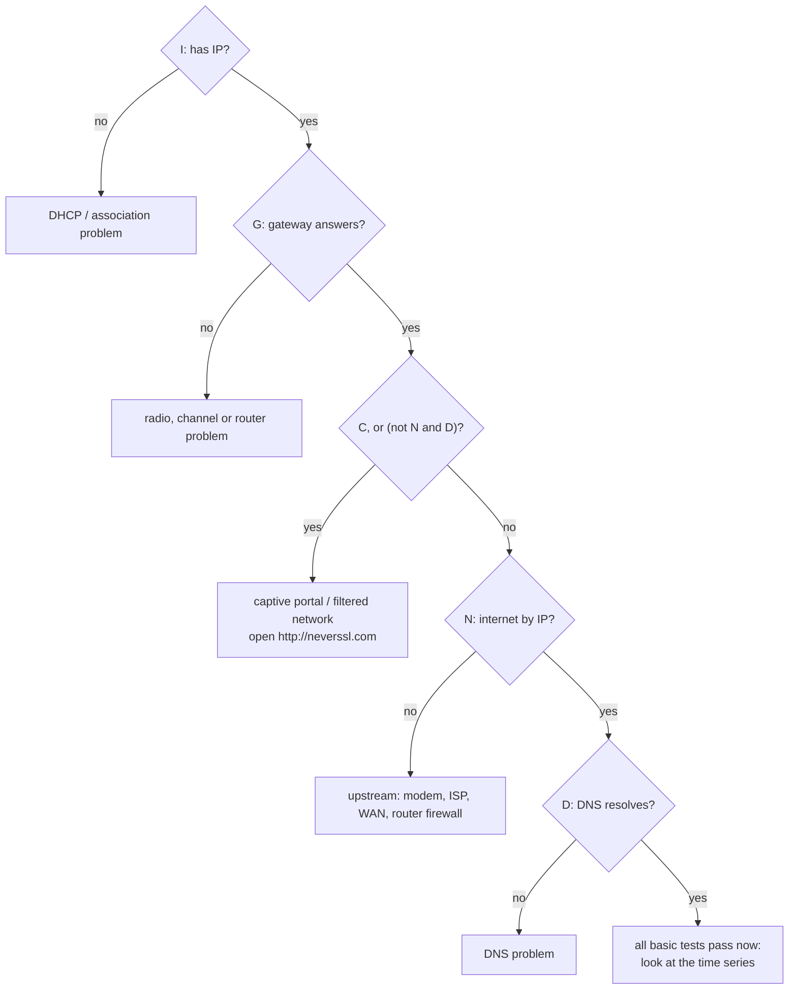

# wifi-doctor: offline Wi-Fi diagnostics for macOS

Two Bash scripts for the situation where a Wi-Fi network is broken and you cannot look anything up
because you are on it. `wifi-diag.sh` runs a layered set of tests on the spot, records everything into
one text report and ends with an automatic verdict. You reconnect to a working network afterwards and
read (or share) the report. `wifi-monitor.sh` logs a CSV row every few seconds for problems that
come and go.

No dependencies beyond the tools shipped with macOS, no network access needed to run, and every
probe has a timeout so a dead network never hangs the script.

## Requirements

- macOS (uses `networksetup`, `system_profiler`, `wdutil`, `ipconfig`, `scutil`, `log show`, `dig`, `nc`, `curl`).
- `sudo` is optional. Without it `wdutil info` and the `pf` status are skipped and the report says so.

## Usage

```sh
git clone <this repo> && cd wifi-doctor

# 1. connect to the problematic network, then
sudo bash wifi-diag.sh

# 2. reconnect to a working network and read the report
less RESULTS-<timestamp>/REPORT.txt
```

Output (next to the script, or in `$WIFI_DOCTOR_DIR` if set):

- `RESULTS-<timestamp>/REPORT.txt`: the full human-readable report
- `RESULTS-<timestamp>/raw/`: raw output of each command
- `wifi-report-<timestamp>.tgz`: both of the above, compressed

Options: `WIFI_IFACE=en1` (default `en0`), `SAMPLE_SECONDS=90`, `SAMPLE_INTERVAL=2`.

For intermittent problems:

```sh
bash wifi-monitor.sh                                  # every 5 s until Ctrl-C
INTERVAL=10 DURATION=1800 bash wifi-monitor.sh        # every 10 s for 30 min
```

which writes `monitor-<timestamp>.csv` with columns
`timestamp, ssid, rssi_dBm, noise_dBm, gateway_ms, internet_ms, dns_ok`.

## What it collects

`wifi-diag.sh` runs 14 stages, bottom of the stack first:



## How the verdict is computed

The summary re-runs four cheap probes and reduces them to booleans:

| Symbol | Probe | True when |
|---|---|---|
| $I$ | `ipconfig getifaddr $IFACE` | the interface has an IPv4 address |
| $G$ | `ping -c 2` default gateway | the router answers |
| $N$ | `ping -c 2 1.1.1.1` | there is an IP path to the internet |
| $D$ | `dig +short` google.com, cloudflare.com, apple.com | at least one of the three resolves |
| $C$ | `curl http://neverssl.com` | the HTTP status is 3xx (plain HTTP is being redirected) |

and walks a fixed priority list, first match wins:



The captive-portal rule is the interesting one:

$$\text{captive} = C \;\lor\; (\lnot N \land D)$$

A walled garden typically lets DNS through (the portal hostname must resolve) while dropping all other
traffic until you accept the terms. So "names resolve but no IP is reachable" is treated as a portal,
not as an ISP outage. DNS uses three domains rather than only `apple.com` because some networks filter
exactly the Apple domains macOS uses for captive-portal detection, which is also why macOS sometimes
never shows the login sheet. The suggested fix is to open a plain-HTTP site, which the portal can
redirect.

### Other derived numbers

- **Signal.** The tips classify RSSI $r$ from the current network as weak for $r \le -75$ dBm, medium for
  $-75 < r \le -67$, good above. The time series records noise $n$ alongside, so
  $\text{SNR} = r - n$ can be read off directly.
- **Path MTU.** Don't-fragment pings with ICMP payloads 1472, 1400, 1200 and 800 bytes test IP packets of
  $s + 28$ bytes (20 B IPv4 header + 8 B ICMP header), i.e. 1500 down to 828.
- **Throughput.** curl's `speed_download` / `speed_upload` in bytes/s, converted as
  $\text{Mbps} = 8\,B / 10^6$, for a 25 MB download and a 10 MB upload against `speed.cloudflare.com`.
  Skipped when there is no internet.
- **Band.** 2.4 GHz vs 5/6 GHz is inferred from the channel string, PHY generation from the PHY mode.

### Timeouts without `timeout`

macOS ships no `timeout(1)`, so every probe goes through a small helper: the command runs in the
background, a second background subshell sleeps $t$ seconds and `kill -9`s it, and whichever finishes
first wins. This bounds the run time even when DNS, traceroute or `log show` would block forever.

## Privacy

The report is designed to be complete, so it is personal: SSID and known-network list, hostname, local
and gateway IPs, MAC addresses (from `ifconfig` and `arp -a`), open sockets and 30 minutes of Wi-Fi
system logs. Read it before sharing it with anyone. The `.gitignore` excludes `RESULTS-*/`,
`wifi-report-*.tgz` and `monitor-*.csv` so results are never committed by accident.

## Limitations

- macOS only, written for recent versions where `networksetup -getairportnetwork` often reports
  "not associated", hence the SSID fallbacks. Without Location Services permission the SSID may be unreadable.
- The verdict uses ICMP for $N$. A network that blocks ping but passes TCP is classified as a captive
  portal or upstream failure; the TCP and HTTP results in stage 12 are in the report to catch that case,
  but they do not feed the verdict.
- The time series runs `system_profiler` and two pings per sample, and the loop counts only the sleep
  interval, so the real duration is longer than `SAMPLE_SECONDS`.
- `wifi-monitor.sh` checks DNS with `apple.com` only.
- The heuristics are rules of thumb, not a substitute for a packet capture.

## License

MIT, see [LICENSE](LICENSE).
